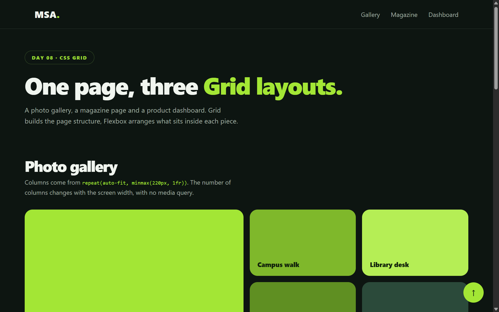
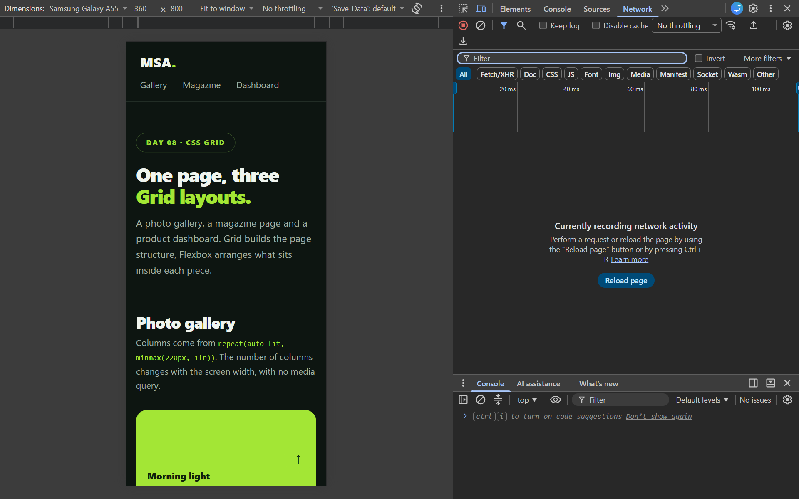

# CSS Grid Gallery and Dashboard

**Day 08 · Web Development · Mohammad Saqib (BCS2026460)**

This project demonstrates CSS Grid and Flexbox by building a responsive photo gallery, a magazine-style layout and a product dashboard. It uses plain HTML and CSS in a single `index.html`, with no frameworks and no external images, and keeps the same dark green and lime theme as Days 1 to 7.

## Screenshots

**Desktop**



**Mobile**



## Project features

- Responsive photo gallery using CSS Grid
- Gallery columns made with `repeat()`, `minmax()` and `auto-fit`
- Magazine layout using named grid areas
- Dashboard with a header, sidebar and product grid
- Product cards arranged with Flexbox
- Layout adjustments for smaller screens

## Where each idea is used

| Section | Layout code | What it does |
|---|---|---|
| Gallery | `grid-template-columns: repeat(auto-fit, minmax(220px, 1fr))` | Columns increase or decrease with screen width, no media query needed |
| Gallery | `grid-column: span 2`, `grid-row: span 2`, `grid-auto-flow: dense` | Some tiles are wider or taller, and dense flow fills gaps |
| Magazine | `grid-template-areas` | Feature, stories, sidebar and quote are placed by name |
| Magazine | Media queries at 900px and 560px | The areas are redefined for tablet and mobile |
| Dashboard | `grid-template-areas: "side head" "side main"` | Header, sidebar and content on desktop, stacked on small screens |
| Dashboard products | `repeat(auto-fill, minmax(200px, 1fr))` | Product grid adjusts to available width |
| Product cards | `display: flex`, `flex-direction: column`, `justify-content: space-between`, `margin-top: auto` | Category and status in a row, price and stock pinned to the card bottom |
| Navbar and header | `display: flex`, `flex-wrap`, `justify-content: space-between` | Flexbox for one-dimensional rows |

## Run it

1. Download or clone this repository.
2. Open `index.html` in a browser.
3. Resize the window, or use DevTools device mode, to see the layout change at 900px and 560px.

## Project files

```text
project-folder/
├── index.html
├── README.md
└── Screenshots/
    ├── desktop.png
    └── mobile.png
```
